# CCNA2 · сверка анимаций (оригинал ↔ Figma Motion)

Галерея приёмки: слева — оригинальный APNG из репозитория курса, справа — наш рендер Figma Motion.
Обе колонки анимируются прямо на GitHub. Решения и комментарии — в приёмочном документе (ссылка в чате).

## 2.1.1 — коммутация: кадр входит во входной порт, по таблице портов пересылается в выходной (EA: 1→4, EE: 5→1, AB: 3→6)

**Вердикт аудита:** needs_fix → исправлено (1 правок), пересобрано и пересверено

| Оригинал | Рендер Figma Motion |
|---|---|
|  | 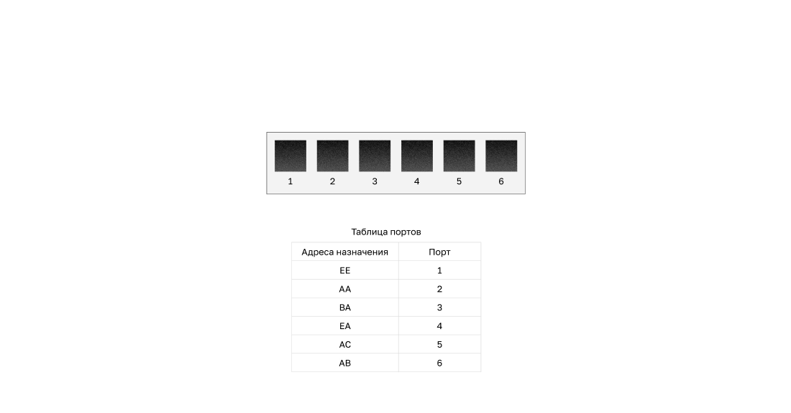 |

## 2.2.2 — широковещательный домен: кадр сервера коммутатор рассылает во все порты; с двумя коммутаторами домен расширяется

**Вердикт аудита:** minor

| Оригинал | Рендер Figma Motion |
|---|---|
|  | 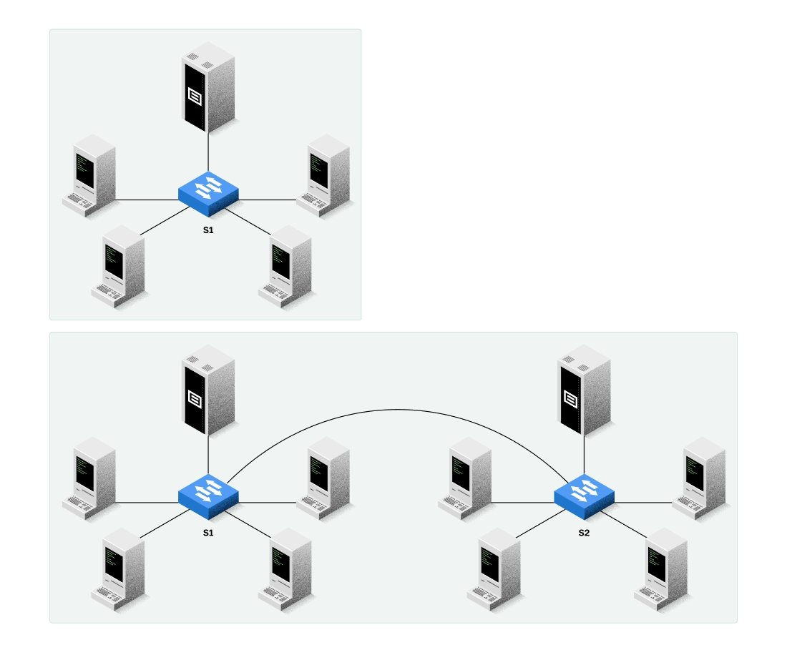 |

## 3.2.2 — сеть без VLAN: широковещательный кадр PC1 коммутаторы S2, S1, S3 рассылают во все порты, его получают все ПК

**Вердикт аудита:** needs_fix → исправлено (3 правок), пересобрано и пересверено

| Оригинал | Рендер Figma Motion |
|---|---|
|  | 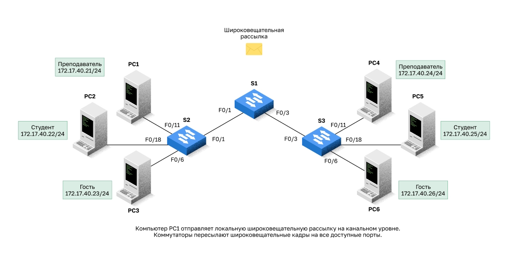 |

## 3.2.3 — сеть с VLAN: широковещательный кадр PC1 (VLAN 10) идёт через S2, S1, S3 только к PC4

**Вердикт аудита:** minor

| Оригинал | Рендер Figma Motion |
|---|---|
|  | 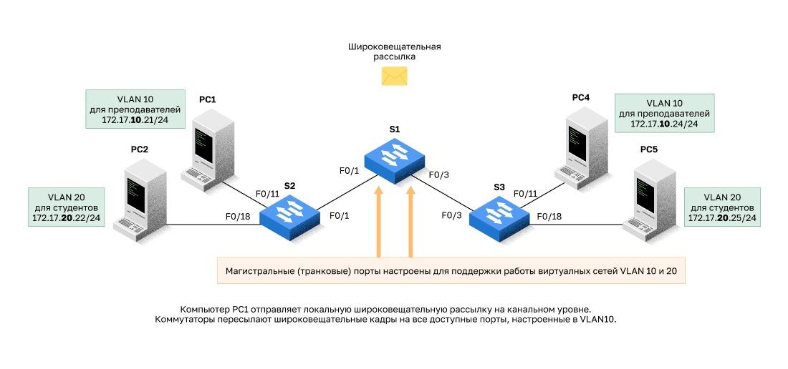 |

## 4.1.3 — Router-on-a-Stick: кадр PC1 (VLAN 10) идёт к PC3 (VLAN 30) через S2, S1 и подынтерфейсы R1, ответ возвращается тем же путём

**Вердикт аудита:** minor

| Оригинал | Рендер Figma Motion |
|---|---|
|  | 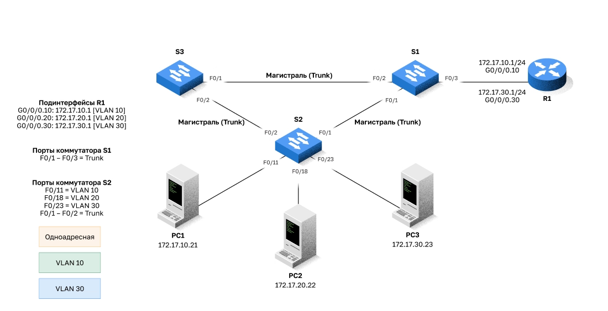 |

## 5.1.2 — STP в нормальном режиме: широковещательный кадр PC1 расходится по сети, S2 отбрасывает копию, пришедшую через заблокированный порт

**Вердикт аудита:** ok

| Оригинал | Рендер Figma Motion |
|---|---|
|  | 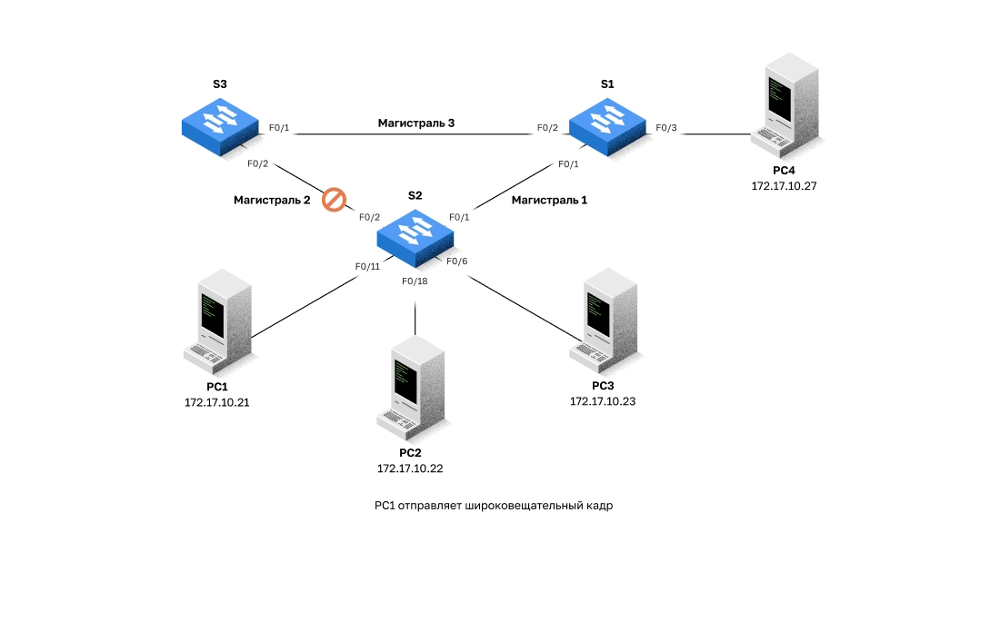 |

## 5.1.3 — перестройка STP после сбоя Магистрали 1: S2 разблокирует порт, широковещательный кадр PC1 расходится через S2, S3 и S1 до PC4

**Вердикт аудита:** minor

| Оригинал | Рендер Figma Motion |
|---|---|
|  | 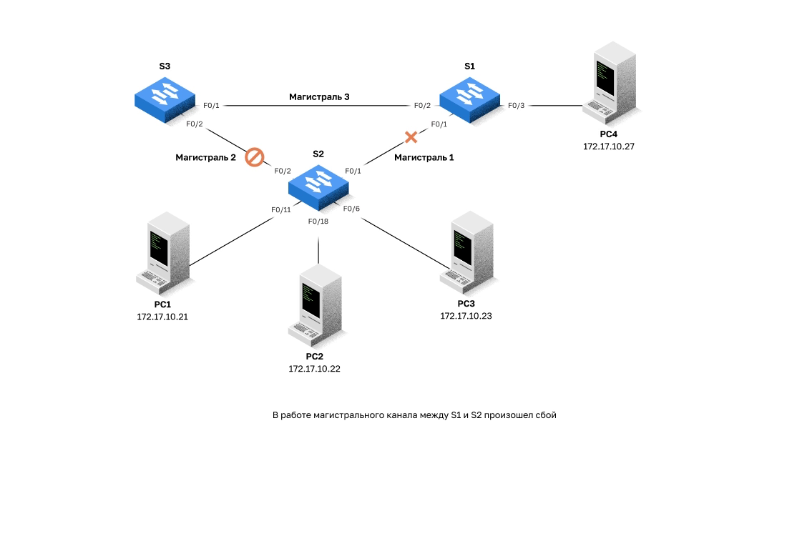 |

## 5.1.5 — петля уровня 2: широковещательный кадр PC1 ходит по кольцу коммутаторов, таблицы MAC-адресов переписываются

**Вердикт аудита:** needs_fix → исправлено (4 правок), пересобрано и пересверено

| Оригинал | Рендер Figma Motion |
|---|---|
|  | 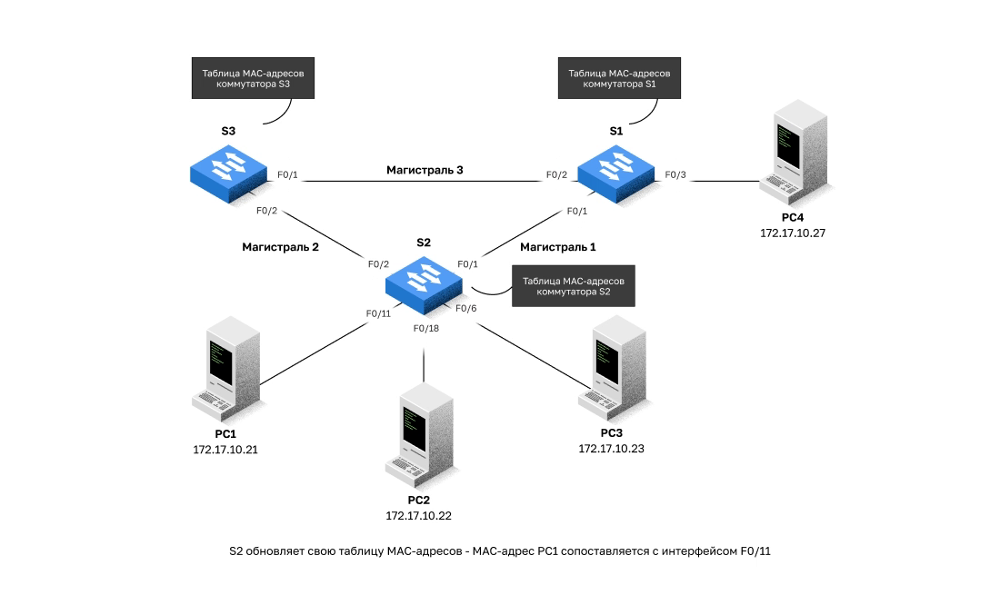 |

## 5.1.6 — широковещательный шторм: кадры PC1, PC4, PC3 размножаются в петле S1–S2–S3, кадр PC2 не обрабатывается

**Вердикт аудита:** needs_fix → исправлено точечным патчем

| Оригинал | Рендер Figma Motion |
|---|---|
|  | 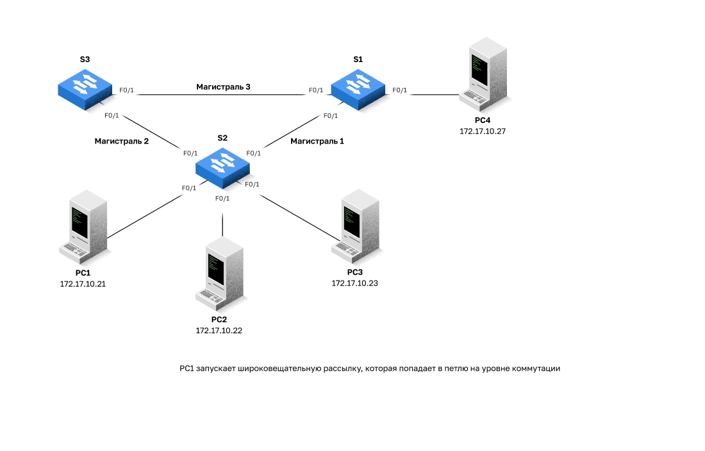 |

## 14.1.2 — функции роутера: пакет идёт от ПК к ПК, R1 и R2 ищут маршрут в таблицах маршрутизации

**Вердикт аудита:** needs_fix → исправлено (1 правок), пересобрано и пересверено

| Оригинал | Рендер Figma Motion |
|---|---|
|  | 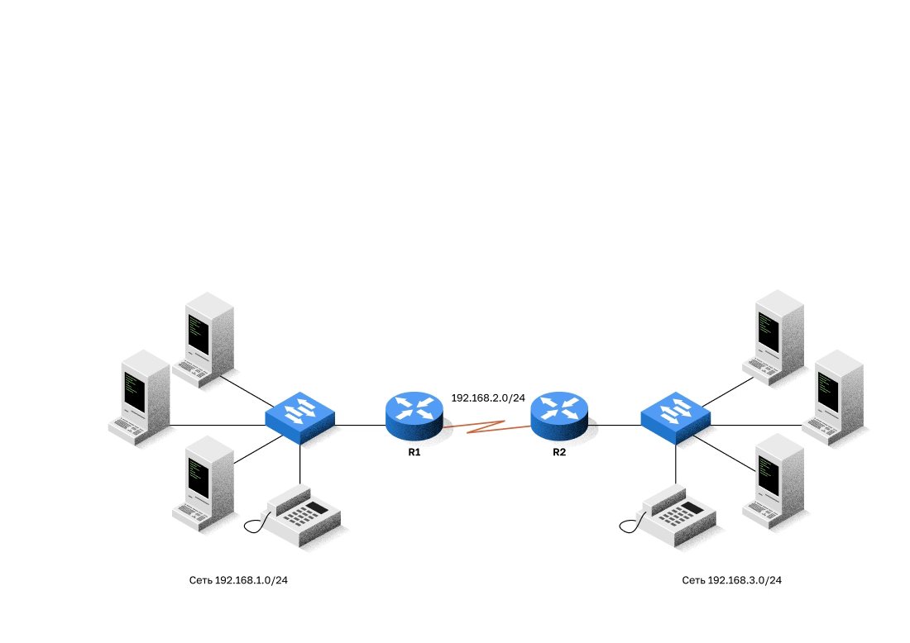 |

## 14.2.2-1 — PC1 отправляет пакет PC2: PC1 рассуждает, собирает кадр (заголовки L3 и L2, ARP-кэш) и отправляет конверт на R1

**Вердикт аудита:** minor

| Оригинал | Рендер Figma Motion |
|---|---|
|  | 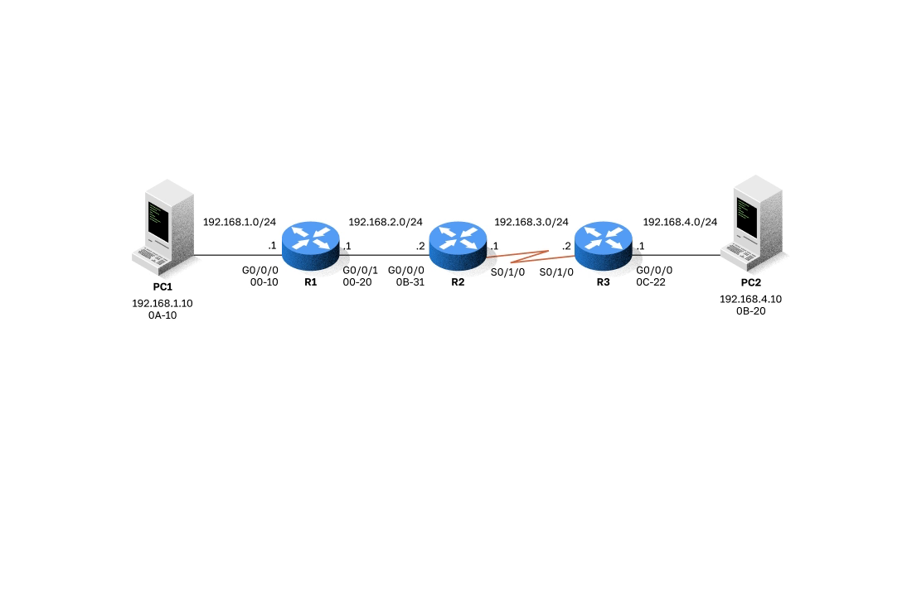 |

## 14.2.2-2 — R1 пересылает пакет на R2: разбирает кадр, ищет маршрут и MAC следующего перехода, собирает новый кадр и отправляет конверт на R2

**Вердикт аудита:** minor

| Оригинал | Рендер Figma Motion |
|---|---|
|  | 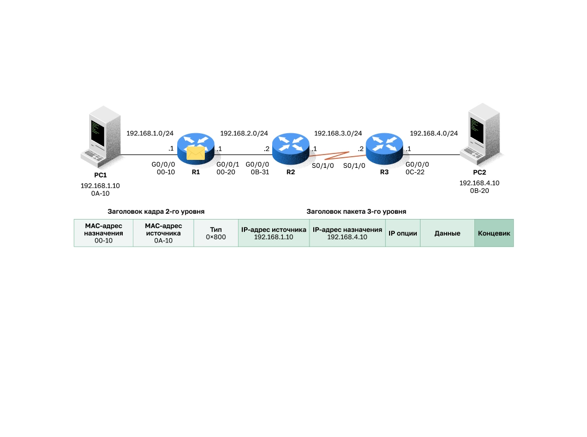 |

## 14.2.2-3 — R2 пересылает пакет на R3 по последовательному каналу: разбирает кадр Ethernet, находит маршрут и инкапсулирует пакет в новый кадр

**Вердикт аудита:** minor

| Оригинал | Рендер Figma Motion |
|---|---|
|  | 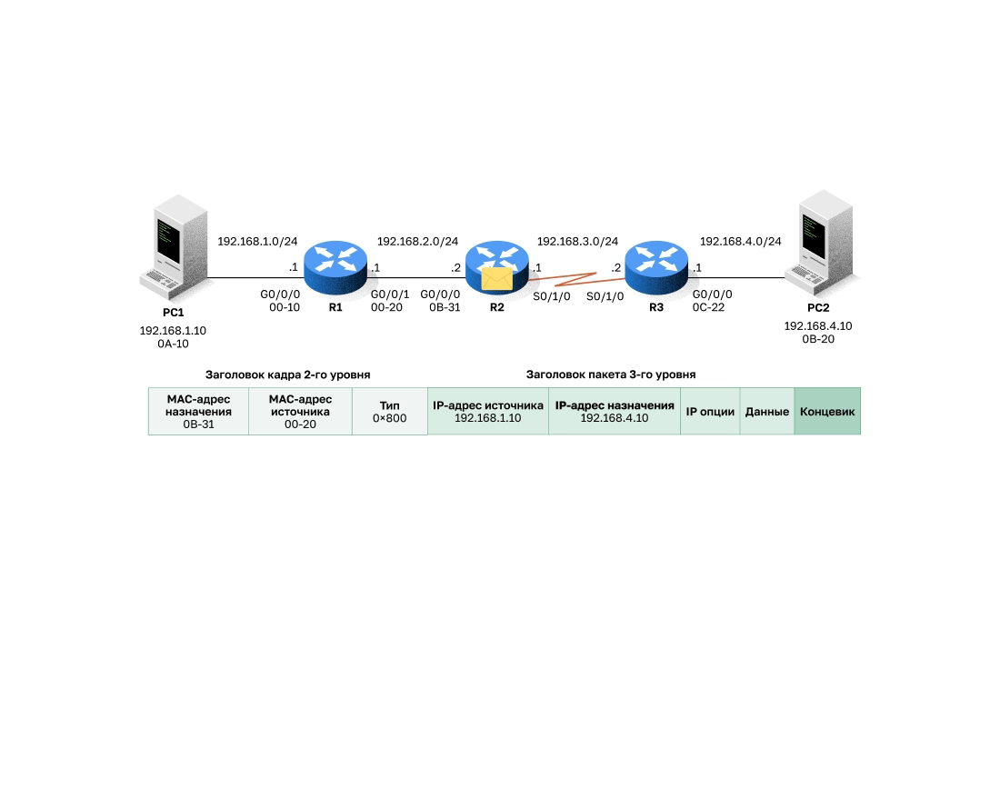 |

## 14.2.2-4 — R3 пересылает пакет на PC2: разбирает кадр последовательного канала, находит маршрут и MAC в ARP-кэше, собирает кадр Ethernet и отправляет его PC2

**Вердикт аудита:** ok

| Оригинал | Рендер Figma Motion |
|---|---|
|  | 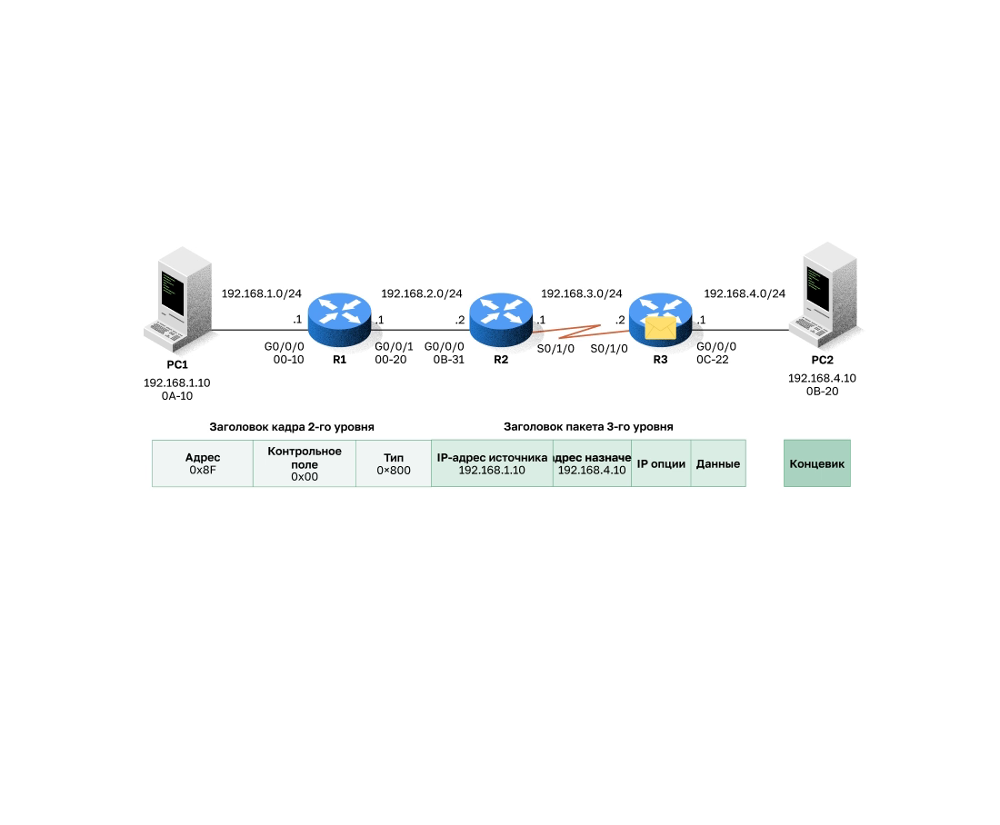 |

## 14.5.3 — обновления протокола маршрутизации: R1, R2 и R3 по очереди рассылают соседям конверты-обновления по последовательным каналам

**Вердикт аудита:** minor

| Оригинал | Рендер Figma Motion |
|---|---|
|  |  |

## 14.5.4 — путь зависит от метрики: по числу переходов конверт идёт PC1 → R1 → R3 → PC2, по пропускной способности — PC1 → R1 → R2 → R3 → PC2

**Вердикт аудита:** minor

| Оригинал | Рендер Figma Motion |
|---|---|
|  | 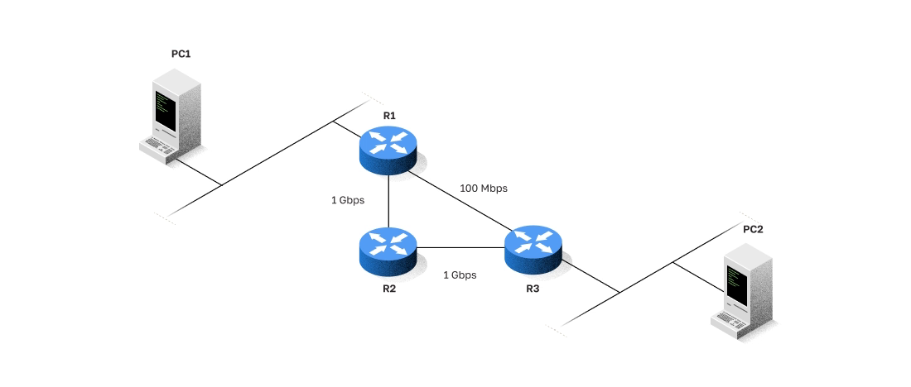 |

## 14.5.5 — распределение нагрузки с равной стоимостью: четыре пакета от PC1 к PC2 идут поочерёдно по двум путям 52 Mbps — R1→R2→R3 и R1→R4→R3

**Вердикт аудита:** minor

| Оригинал | Рендер Figma Motion |
|---|---|
|  | 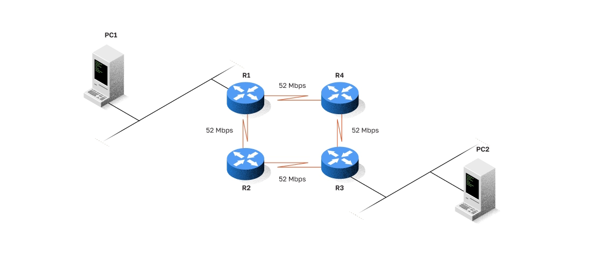 |

## 16.1.1 — пересылка пакета по статическим маршрутам: конверт идёт от PC1 через R1, R2, R3 к PC3

**Вердикт аудита:** needs_fix → исправлено (1 правок), пересобрано и пересверено

| Оригинал | Рендер Figma Motion |
|---|---|
|  | 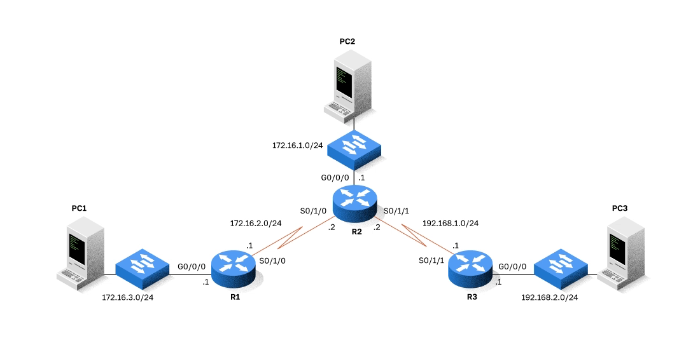 |